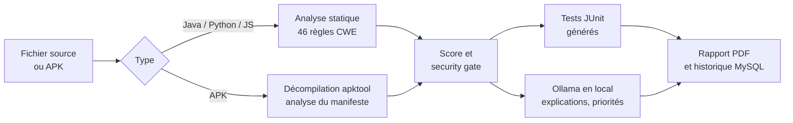

# SecTest : générateur de tests de régression de sécurité

Application web qui analyse du **code source** (Java, Python, JavaScript) ou une **application Android (APK)**,
détecte les vulnérabilités, génère automatiquement les **tests JUnit** qui empêchent leur réapparition,
et produit un rapport PDF avec un score de sécurité. Un modèle de langage exécuté en local (Ollama) explique
chaque risque et priorise les corrections, sans envoyer le code vers un service externe.

Projet 13 du module DevSecOps, ENSA Marrakech (filière GCDSTE, 2025-2026), encadré par le Pr. Mohamed Lachgar.

## Fonctionnement



1. **Analyse statique par règles** : 46 règles réparties entre Java (20), Python (12) et JavaScript (14),
   chacune associée à un identifiant CWE et à une recommandation de correction.
2. **Analyse d'APK** : décompilation avec apktool, puis contrôle du manifeste Android
   : permissions dangereuses classées par criticité, composants exportés sans permission,
   `android:debuggable`, `android:allowBackup` et trafic HTTP en clair autorisé.
3. **Score et security gate** : score sur 100 pondéré par la sévérité ; le statut passe à `BLOCKED`
   dès qu'une vulnérabilité critique est détectée.
4. **Génération de tests** : une classe JUnit 5 avec un test par vulnérabilité, pour vérifier qu'une faille corrigée ne revient pas.
5. **Assistance IA locale** (Ollama, llama3.2) : explication du risque en français, priorisation des corrections
   et proposition de tests plus ciblés. Si Ollama n'est pas disponible, l'analyse fonctionne sans.
6. **Rapport PDF** et historique des analyses.

Exemples de règles :

| Langage | Exemples de vulnérabilités détectées |
|---|---|
| Java | Injection SQL (CWE-89), injection de commandes, XXE, désérialisation non sécurisée, secrets en dur (CWE-798), MD5 / SHA-1, path traversal |
| Python | Injection SQL, injection de commandes, `pickle` non sécurisé, mode debug, aléatoire non cryptographique |
| JavaScript | `eval()`, XSS via `innerHTML`, injection NoSQL, JWT non sécurisé, prototype pollution, SSRF, cookies sans `Secure` / `HttpOnly` |

## API

| Méthode | Route | Rôle |
|---|---|---|
| POST | `/api/analyze` | Analyse un fichier source ou un APK |
| GET | `/api/report/{id}/pdf` | Télécharge le rapport PDF |
| GET | `/api/tests/{id}` | Récupère les tests JUnit générés |
| GET | `/api/history` | Liste les analyses précédentes |
| GET | `/api/health` | État du service |

L'interface web est servie à la racine (`/`).

## Lancer le projet

Prérequis : Java 17, Maven, MySQL, et en option [Ollama](https://ollama.com) avec le modèle `llama3.2`.

```bash
# 1. Pour l'analyse d'APK : télécharger apktool et le placer ici
#    https://apktool.org  ->  src/main/resources/apktool.jar

# 2. Fournir les identifiants de la base (jamais dans le code)
export DB_USERNAME=root
export DB_PASSWORD="..."

# 3. (optionnel) Lancer le modèle local
ollama pull llama3.2

# 4. Démarrer l'application
mvn spring-boot:run      # puis ouvrir http://localhost:8080
```

Tests unitaires : `mvn test` (détection d'injection SQL, de secrets en dur et de MD5, génération des tests, attribution de la sévérité).

## Stack

Java 17 · Spring Boot 3.2 · Spring Data JPA · MySQL · apktool · Ollama (llama3.2) · iText (PDF) · JUnit 5 · HTML / CSS / JavaScript

## Projet lié

[SecurityRegTest](https://github.com/hiba05555/security-regression-tool) : la version en ligne de commande (Python) du même générateur,
intégrée à un pipeline GitHub Actions, qui a fait l'objet d'un article scientifique.

---

Équipe : Malak Lahnine, Sara Jamiri, Fatimezzahra Ennassiri, Hiba Chagdaly.
